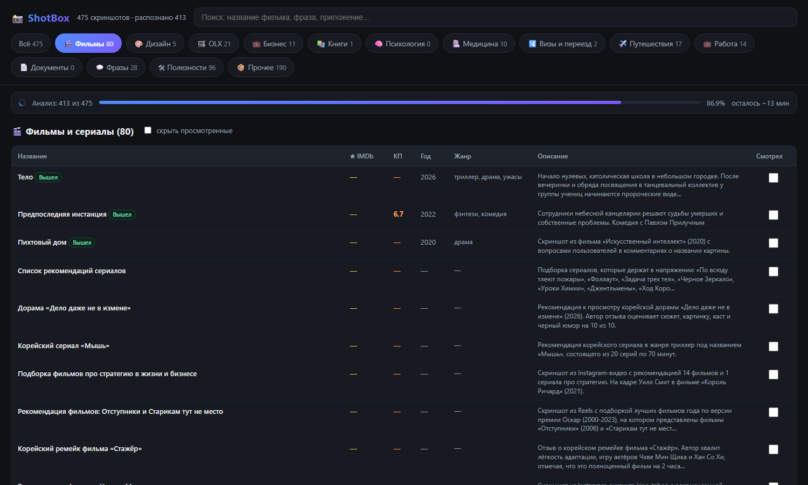

# 📸 ShotBox — галерея-органайзер скриншотов

Личная галерея скриншотов с автоматической сортировкой по смысловым разделам.
Загружаете скриншоты с телефона/компьютера — приложение раскладывает их по папкам
«Фильмы», «Дизайн», «OLX», «Медицина», «Работа» и т.д.



## ✨ Возможности

- **14 разделов**: Фильмы (фильмы/сериалы/мультфильмы), Дизайн, OLX, Бизнес, Книги,
  Психология, Медицина, Визы и переезд, Путешествия, Работа, Документы, Фразы,
  Полезности, Прочее
- **Автоклассификация** через Gemini (vision): модель смотрит скриншот и определяет,
  зачем он сохранён
- **Таблица фильмов** с рейтингами IMDb и Кинопоиска, годом, жанром, описанием,
  статусом («Вышел / Идёт / Скоро») и галочкой «смотрел»
- **Метаданные без ИИ** — парсер Kinopoisk API (точные рейтинги, русские названия)
- **Миниатюры** генерируются автоматически (Pillow)
- **Дедупликация** по MD5 — копии скрываются, показывается счётчик `×N`
- **Поиск** по названию, описанию, отзыву и приложению
- **Редактор карточки**: категория, название, отзыв, оценка ★
- **Плашка прогресса** анализа в реальном времени

## 🏗 Стек

| Компонент | Технология |
|---|---|
| Backend | FastAPI + SQLite |
| Frontend | Vanilla JS, один HTML-файл |
| Миниатюры | Pillow |
| Классификация | Google Gemini (vision) |
| Метаданные фильмов | Kinopoisk API (unofficial) |

## 🚀 Установка

```bash
git clone https://github.com/MelNikVl/myspace.git
cd myspace/shotbox

python3 -m venv venv
./venv/bin/pip install -r requirements.txt

cp .env.example .env
# впишите свои ключи:
#   GEMINI_KEY=...   (Google AI Studio)
#   KP_KEY=...       (kinopoiskapiunofficial.tech)

# положите скриншоты в photos/<год-месяц>/*.jpg
./venv/bin/python scripts/make_thumbs.py   # миниатюры + база
./venv/bin/python scripts/dedup.py         # дедупликация

# классификация (нужна квота Gemini: 500 запросов/день на free tier)
./venv/bin/python scripts/analyze_all.py

# метаданные фильмов (Kinopoisk, 500 запросов/день)
./venv/bin/python scripts/enrich_kp.py

./venv/bin/uvicorn app:app --host 0.0.0.0 --port 8090
```

Открыть: `http://localhost:8090`

## ⚙️ Systemd

```ini
[Unit]
Description=ShotBox gallery of screenshots
After=network.target

[Service]
Type=simple
User=YOUR_USER
WorkingDirectory=/path/to/shotbox
ExecStart=/path/to/shotbox/venv/bin/uvicorn app:app --host 0.0.0.0 --port 8090
Restart=always

[Install]
WantedBy=multi-user.target
```

## 📡 API

| Метод | Путь | Описание |
|---|---|---|
| GET | `/api/items?category=&q=&dedup=` | Список скриншотов |
| GET | `/api/films` | Таблица фильмов с метаданными |
| GET | `/api/stats` | Счётчики по категориям |
| GET | `/api/progress` | Прогресс анализа |
| POST | `/api/items/{id}` | Обновить карточку (`category`, `title`, `review`, `rating`, `watched`) |

## 📁 Структура

```
shotbox/
├── app.py                 # FastAPI (API + отдача файлов)
├── static/index.html      # весь фронтенд
├── scripts/
│   ├── make_thumbs.py     # миниатюры + первичное заполнение БД
│   ├── dedup.py           # поиск дублей по MD5
│   ├── analyze_all.py     # классификация через Gemini
│   └── enrich_kp.py       # рейтинги/годы/жанры через Kinopoisk API
├── photos/                # исходники (не в git)
├── thumbs/                # миниатюры (не в git)
└── data/shotbox.db        # SQLite (не в git)
```

## 💡 Заметки

- **Квоты**: Gemini free tier — 500 запросов/день на проект; Kinopoisk — 500/день.
  Скрипты умеют ждать и продолжать с места остановки.
- **Приватность**: при классификации каждое изображение отправляется в Google.
  Полностью локальный вариант — Ollama + Qwen2-VL (нужно 20-40 ГБ).
- **Дедупликация** считает MD5 содержимого — одинаковые файлы под разными именами
  схлопываются.

## 📄 Лицензия

MIT
